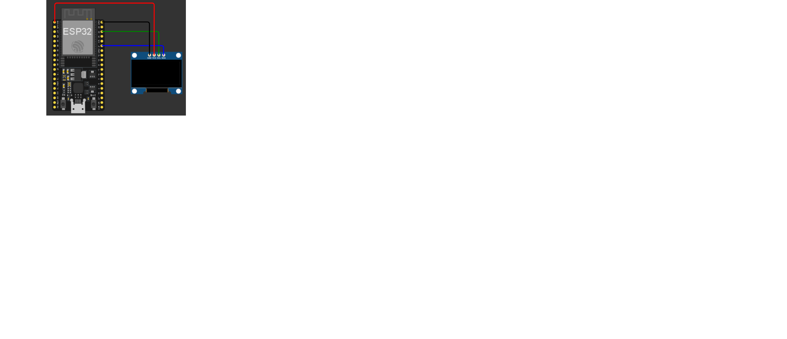

Animação em Micropython - Amigo virtual PET  

 

## :pushpin: Descrição

Nosso projeto consiste em uma animação de um jogo no estilo de "bichinho virtual", tematizado com o mascote do programa PET-SI. O projeto conta com sprites iniciais que poderão ser usados futuramente para um jogo no estilo de "Tamagotchi", contendo uma animação de "stand-by" e uma de dúvida.

 

## :robot: Montagem do dispositivo físico

### Lista de materiais

| Quantidade | Nome | Link para referência |
| --- | --- | --- |
| 1 | ESP32 e cabo USB | https://www.baudaeletronica.com.br/placa-doit-esp32-bluetooth-e-wifi.html |
| 1 | Display OLED SSD1306 | https://www.mercadolivre.com.br/modulo-de-display-oled-096-polegadas-128x64-i2c-spi-ssd1306/p/MLB2094680074?pdp_filters=item_id%3AMLB7623424740&from=gshop&matt_tool=36897333&matt_word=&matt_source=google&matt_campaign_id=24072337389&matt_ad_group_id=201646451751&matt_match_type=&matt_network=g&matt_device=c&matt_creative=818746220522&matt_keyword=&matt_ad_position=&matt_ad_type=pla&matt_merchant_id=735128188&matt_product_id=MLB2094680074-product&matt_product_partition_id=2494360127015&matt_target_id=pla-2494360127015&cq_src=google_ads&cq_cmp=24072337389&cq_net=g&cq_plt=gp&cq_med=pla |
| 1 | Fonte de alimentação - PowerBank | https://www.amazon.com.br/Power-Geonav-10-000mAh-USB-C-espacial/dp/B0CNH9WK1H/ref=asc_df_B0CNH9WK1H?mcid=97951b9a0466376abf732037adb368c7&hvadid=709964502887&hvpos=&hvnetw=g&hvrand=9815242386640242301&hvpone=&hvptwo=&hvqmt=&hvdev=c&hvdvcmdl=&hvlocint=&hvlocphy=9197956&hvtargid=pla-2275983322978&psc=1&hvocijid=9815242386640242301-B0CNH9WK1H-&hvexpln=0&language=pt_BR |

### Lista de conexões

| Componente | Pino da placa |
| --- | --- |
| Display SSD1306 | 21, 22, GND .2 e 3v3|

### Funcionamento dos componentes

#### Display SSD1306

O SSD1306 é um controlador utilizado em displays LED, ele recebe informações do ESP32 por meio da comunicação I2C.
Os dados são armazenados em uma memória interna, que determina quais pixels devem acender ou apagar, a qual deixa possível exibir textos, números, símbolos e imagens na tela.

(Especificação técnica: https://randomnerdtutorials.com/esp32-ssd1306-oled-display-arduino-ide/).

### Circuito

Figura - Diagrama do circuito 
   

O display presente no circuito se comunica através da interface I2C, utilizando os pinos GPIO 21 e 22. Além disso, devido sua simplicidade, ele pode ser portado em qualquer ambiente, mas recomenda-se a adição de uma proteção ao circuito. 
 

 

## :electric_plug: Funcionamento do sistema

O sistema se baseia principalmente na biblioteca Framebuf, que permite a exibição de imagens no display SSD1306 por meio de arrays contendo a luminosidade de cada pixel da tela. As animações foram feitas através de um site próprio para a criação de pixel arts, e foram convertidas para os arrays.

 

## :busts_in_silhouette: Contribuir no projeto

### Features implementadas

- [x] Animações iniciais do projeto*

### Features para incrementar no projeto

- [ ] Novas animações*
- [ ] Sistema de interação com mascote*

